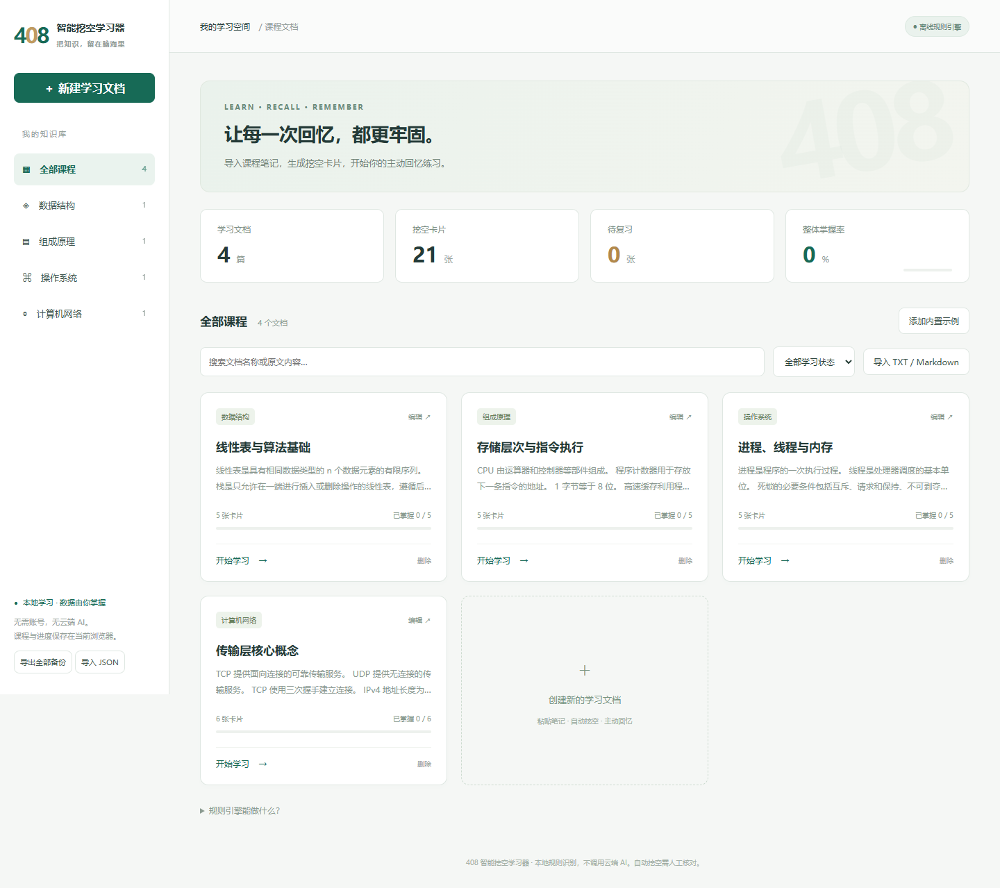

# 408 智能挖空学习器

桌面优先的中文本地 Web 应用。纯 HTML / CSS / JavaScript，无第三方前端依赖，不需要账号、API 密钥或联网。

## Windows 安装版

从 [GitHub Releases](https://github.com/tansheng221/408-study/releases/latest) 下载 `408-Study-Setup-1.0.0-win-x64.exe`，安装后双击桌面快捷方式即可使用，无需另装 Node.js。详见 [安装说明](INSTALL.md)。



## 源码版启动

推荐安装 Node.js 18 或以上版本，在此目录运行：

```text
npm start
```

或在 Windows 双击 `start.cmd`。浏览器访问 http://127.0.0.1:4080 。终端按 Ctrl+C 停止。

也可直接双击 `index.html` 使用；但 file:// 的本地存储行为取决于浏览器，推荐固定使用上述本地地址。不同浏览器、端口或打开方式的数据互不共享。

## 使用

1. 首次打开自带四科示例。新建文档，填写名称、选择课程、粘贴文本，或导入 UTF-8 TXT / Markdown。
2. 选择知识点、定义、事实数字、算法或混合模式，以及每句最多 1–3 个挖空。生成后自动保存。
3. 在编辑区修改各空答案；在只读原文框内选中文字，点击“将选中文字设为挖空”添加手动卡片。每张卡片可删除。修改答案会将该卡片重置为未学习。
4. 开始学习，显示或隐藏答案、前后切换，标记已掌握或待复习；按状态筛选卡片。原句保留，完整原文可展开查看。
5. 知识库按课程、标题或正文搜索、学习状态筛选；统计覆盖全部文档。状态筛选为“文档中包含该状态的卡片”。
6. 侧栏导出全部 JSON，或在学习页导出单篇 JSON、Markdown、打印。打印包含练习、独立答案页和完整原文，可在浏览器打印对话框中另存 PDF。

快捷键：学习页空格显示/隐藏答案，左右方向键切换，1 标记待复习，2 标记已掌握。输入框及按钮获得焦点时不拦截快捷键。

## 数据与边界

- 使用当前浏览器的 localStorage 保存文档、答案与状态；数据不会发送到服务器。服务器仅提供静态文件，不接收课程内容。
- 建议定期导出 JSON。清理浏览器数据、无痕窗口关闭、磁盘或存储配额问题可能导致数据丢失。保存失败会显示提示，此时请立即导出。
- JSON 为 `{ "version": 1, "docs": [...] }`；导入进行字段、课程、状态和挖空范围校验，追加文档并重新分配 ID，不覆盖已有文档。重复导入会形成副本。
- 单篇原文最多 20 万字符，导入文件最多 10 MB，备份导入后最多 500 篇文档。
- 自动规则仅匹配内置术语、定义句式、数字/单位、算法名、步骤提示和复杂度表达式；不理解语义、不验证知识正确性、不具备云端 AI 或大模型能力。数字规则可能匹配 IPv4 等名称中的数字，需要人工检查。没有匹配时保存原文，允许手动挖空。
- 按换行及中文句号、问号、感叹号切分卡片。原文完整保留，不执行 Markdown/HTML 内容。支持文本，不直接解析 PDF、Word、图片和 OCR。
- 重新生成卡片会经确认后清除该篇旧卡片与进度；仅修改名称和分类可使用独立保存按钮。原文输入需点击生成才保存。单人单浏览器使用；不提供多标签冲突合并、云同步、自动间隔复习或账号体系。

## 代码与测试

- `index.html`：入口；`style.css`：响应式界面和打印样式。
- `app.js`：知识库、编辑、学习、存储、导入导出。
- `engine.js`：可独立测试的规则引擎、备份校验和 Markdown 导出。
- `server.js`：仅绑定本机的零依赖静态服务器。

运行 `npm test` 验证规则、原文位置、重叠处理、备份往返及非法数据拒绝。

课程内容只保存在使用者的浏览器中，不会上传到 GitHub。仓库仅包含应用代码及示例；安装包通过 Releases 分发。
